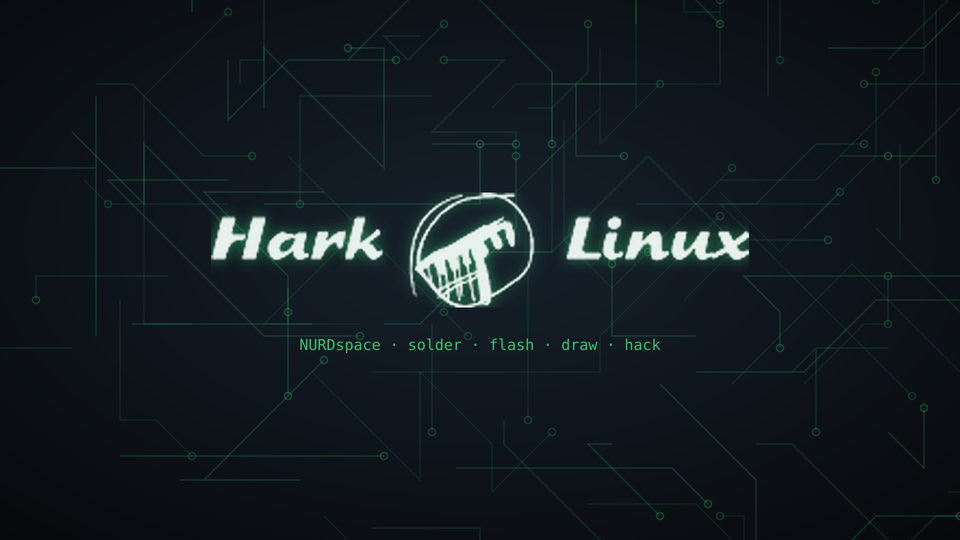

# Hark Linux



**The NURDspace distro.** Hark Linux is a Debian-based distro for new installations at [NURDspace](https://nurdspace.nl/Hark_Linux): boot it from USB or over the network ([HARKboot](https://nurdspace.nl/HARKboot)), plug in an Arduino or ESP32 and get going. It uses a light LXQt desktop and is tuned to run on old PCs and laptops.

English is the default language. You can switch it on the login screen, with `hark-language`, or with a boot option (see [Language](#language)). The Hark tools are bilingual (English/Dutch).

## Features (from the wiki page)

| Wiki feature | How Hark does it |
|---|---|
| LTS support | Debian 13 "trixie" (the current stable release; Debian 14 is expected mid-2027). The 64-bit edition takes its kernel, firmware and microcode from **trixie-backports** for newer hardware; everything else stays on stable. Debian 13 is supported until August 2030 (3 years regular + 2 years LTS). The 32-bit edition is on Debian 12, which has LTS until June 2028. Installed machines get **automatic security updates** (unattended-upgrades); live sessions don't. |
| LDAP integration | `sudo hark-ldap` asks for server, base DN and an optional bind DN, then sets up nslcd, NSS, PAM and auto-created home directories. It is **off by default**, so machines outside the space never wait for an LDAP server. `hark-ldap test` checks it and `sudo hark-ldap off` undoes it. |
| ~~LXDE~~ → **LXQt** for older hardware | The wiki page is from 2023. LXDE is built on GTK2 and its developers moved to LXQt, its successor. LXQt has about the same footprint, is actively developed and is on track for Wayland. Openbox runs as window manager with animations off. |
| Hark logo as menu button and wallpaper | The Hark logo from the wiki is the start button (bottom left) and the wallpaper. |
| "Hark" sound on the menu button | The Hark button, the **Super** key and **Alt+F1** play a sound and open the menu (jgmenu). An original placeholder "chirp" ships with Hark. To use your own sound, drop it in via `hark-tools` → *Hark sound of the menu button*, or put it in `/usr/share/hark/sounds/hark-custom.wav` before you build. |
| Terminator as main terminal | Terminator is the default terminal everywhere (`x-terminal-emulator`, LXQt, PCManFM-Qt, Ctrl+Alt+T). |
| DisplayCAL | Included if the Debian release ships it. |
| Hardinfo, hdparm, sysbench, glmark2 | Included, plus inxi, smartmontools, stress-ng. `hark-tools` → *Benchmarks* runs them for you. |
| cmatrix, hollywood | Included. |
| WINE, DOSBox, VICE, PICO-8 | WINE, DOSBox (Staging) and VICE are included. PICO-8 is commercial, so `hark-tools` installs it from your own licensed zip. |
| Browser bookmarks, add-ons, homepage | Firefox ESR policies: a local welcome page as homepage, a NURDspace bookmarks toolbar (wiki, Jarvis, HARKboot, maker docs), uBlock Origin, telemetry off. |
| Available on HARKboot | `harkboot/to-harkboot.sh` puts an ISO on the PXE server and prints the pxelinux menu entry. |

## What else is in it

| Category | Software |
|---|---|
| **Arduino / ESP32** | Arduino IDE 1.8, arduino-cli (ESP32/ESP8266/RP2040 board URLs pre-configured), PlatformIO, esptool, avrdude + gcc-avr, ARM toolchain, OpenOCD, dfu-util, gdb-multiarch |
| **MicroPython** | Thonny, mpremote, ampy, picotool |
| **Serial and measuring** | picocom, minicom, CuteCom, PulseView + sigrok, i2c-tools, mosquitto-clients |
| **Raspberry Pi / Sense HAT** | sense-hat library, Sense HAT emulator (`sense_emu_gui`), rpi-imager |
| **Drawing** | GIMP, Inkscape, Krita, MyPaint, ImageMagick, Audacity |
| **CAD / PCB / 3D** | FreeCAD, LibreCAD, OpenSCAD, SolveSpace, KiCad, PrusaSlicer, Fritzing, QElectroTech, Dia |
| **Programming** | build-essential, CMake, Geany, Meld, Git, GHex, Python 3 + pipx |
| **Network** | nmap, Wireshark, tcpdump, iperf3, mtr, netcat, avahi |
| **64-bit only** | Blender, Scribus, radare2, Arduino IDE 2 (via `hark-tools`) |

Packages marked optional in `0200-hark-extras.hook.chroot` are installed when the Debian release has them. A missing one is skipped and logged, so it never breaks the build.

Hark's own tools: `hark-tools` (toolbox menu), `hark-welcome` (cheat sheet, shown at first login), `hark-language`, `hark-ldap`, and `hark-menu` (the Hark button). There are also udev rules for CH340, CP210x, FTDI, Espressif, Arduino, Pi Pico, ST-Link, USBasp and logic analyzers, so they work without sudo. Example projects are in `~/hark-examples`.

## Old hardware

| | 64-bit ISO (`amd64`) | 32-bit ISO (`i386`) |
|---|---|---|
| Base | Debian 13 "trixie" + backports kernel | Debian 12 "bookworm" |
| CPU | any x86-64 (Core 2, Athlon 64 and newer) | Pentium 4/M, Atom, Celeron M (`686` kernel, no PAE needed) |
| RAM | 1 GB works, 2 GB+ comfortable | 1 GB works |
| Disk (installed) | 16 GB | 12 GB |

Tuning: zram swap (zstd, 60%), earlyoom, LXQt + Openbox without animations, no recommended packages, rarely used services off, Firefox with fewer content processes, and a 50 MB journal cap.

## Language

- **Default:** English (US), US keyboard, Europe/Amsterdam time zone.
- **On the login screen:** use the language indicator in the top bar.
- **On a running system:** `hark-language` (also in the menu as *Language and keyboard*) offers English (US/UK), Nederlands and Deutsch, plus US, US-international, UK, German and Belgian keyboards.
- **At boot:** edit the boot entry and change `locales=en_US.UTF-8,…` to put `nl_NL.UTF-8` first, or change `keyboard-layouts=us`.
- **Build-time default:** `--bootappend-live` in `auto/config`.

The Hark tools follow the session language. Dutch strings live next to the English ones (`_t "English" "Nederlands"` in `/usr/lib/hark/i18n.sh`), so adding a language means adding a column.

## Building

You need Debian (or Docker), about 20 GB of free disk space and internet access.

```bash
sudo apt install live-build
./build.sh            # 64-bit ISO
./build.sh i386       # 32-bit ISO
./build.sh amd64 docker   # on any Linux host with Docker
```

Quick test: `qemu-system-x86_64 -enable-kvm -m 2048 -cdrom hark-linux-0.1-amd64.hybrid.iso`

After a build, `chroot/var/log/hark-extras.log` shows which optional packages made it in.

GitHub Actions (`.github/workflows/build.yml`) builds both ISOs on demand or on a `v*` tag. GitHub release assets are limited to 2 GB, so if the 64-bit ISO is bigger, download it from *Artifacts*.

## HARKboot

On the HARKboot server:

```bash
sudo ./harkboot/to-harkboot.sh hark-linux-0.1-amd64.hybrid.iso /tftpboot /var/www/html http://<server-ip>
```

This copies the kernel and initrd to `/tftpboot/entries/hark-linux/<arch>/` and the squashfs to the web root, then prints the `pxelinux.cfg/default` entries. There are two variants: `fetch=` over HTTP, which loads the whole squashfs into RAM, and NFS for machines with little memory. HARKboot currently only runs TFTP, so one of the two needs an HTTP or NFS server next to it.

## Artwork

Everything comes from one file: `artwork/hark-logo-source.png`, the Hark Linux logo from the NURDspace wiki. To regenerate the menu icons, the light/dark logos and the wallpaper:

```bash
python3 artwork/make-artwork.py
```

The source file in this repo was cut from a phone screenshot of the wiki. Replace it with the original `File:Hark_Linux_Logo_V0-1.png` for sharper results.

## Customising

| What | Where |
|---|---|
| Required packages | `config/package-lists/*.list.chroot` |
| Optional packages, pip/pipx tools | `config/hooks/normal/0200-hark-extras.hook.chroot` |
| Desktop (panel, shortcuts, theme) | `config/includes.chroot/etc/skel/.config/lxqt/` |
| Old-hardware tuning, LTS updates | `config/hooks/normal/0300-hark-old-hardware.hook.chroot` |
| Bookmarks and add-ons | `config/includes.chroot/etc/firefox-esr/policies/policies.json` |
| Boot options (language, keyboard, user) | `auto/config` |

The live user is `nurd` with no password.

## Licence

Build scripts: MIT. The Hark Linux logo belongs to NURDspace. All bundled software is under its own licence.
